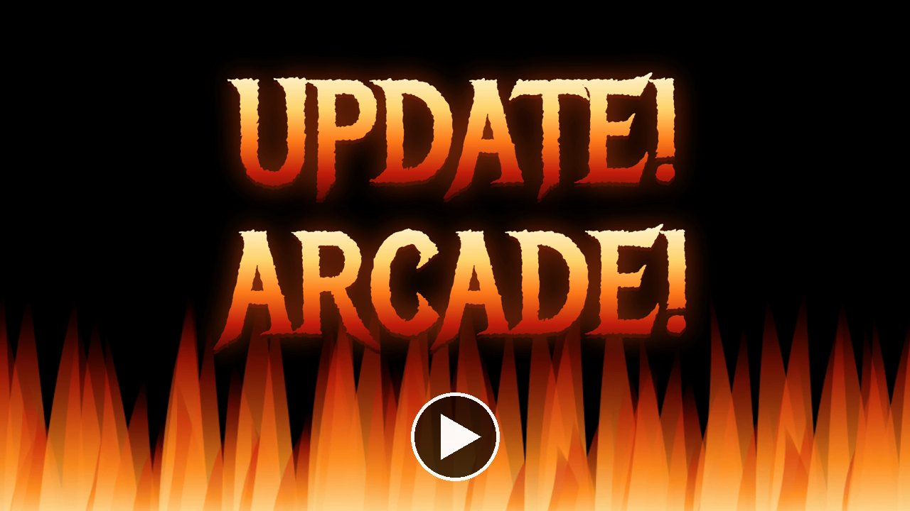

# Update Arcade

Watching `omarchy update` compile things is fun the first time. By the fortieth
time, it's about as gripping as the test pattern after the station signs off.

[](https://www.youtube.com/watch?v=_3-zkQPtRpg)

*The trailer: two minutes, four voices, one heavy metal soundtrack, and a surfer
who has read the same build log nine times.*

Update Arcade puts a little **Play Asteroids** button in the top-right corner of
the update terminal. Press it and the scrolling output is swapped for a vector
Asteroids game drawn in your theme's colors. The update keeps chugging along
underneath; a strip along the bottom of the game tells you what it's up to.

When the update needs you (a sudo password, a "Remove orphaned packages?", a
reboot question), the game pauses and steps aside on its own, so you're never
the person who blew up rocks through a prompt for ten minutes. Answer it, hit
the button again, and you're back where you left off.

## Controls

| Key | Does |
| --- | --- |
| ← → / A D | Turn |
| ↑ / W | Thrust |
| Space | Fire (and start a game) |
| ↓ / S / Shift | Hyperspace |
| P | Pause |
| M | Mute (remembered) |
| Esc | Back to the update |
| Q | Close the game, once the update is complete (a letter while signing initials) |

Extra ship every 10,000 points. Every so often a flying saucer drifts across
taking potshots: the big one (200) sprays at random, the small one (1,000)
actually aims, and it shows up more the better you're doing. Its shots break
rocks too, but you don't get the points. Rude.

## Sound

Pew, boom, and the dread *dum-dum dum-dum* heartbeat that speeds up the longer
a wave drags on, plus the saucer siren and thrust rumble. All of it is
synthesized by `tools/make-sounds.py`, no samples borrowed from anybody's
cabinet. Sound uses Qt Multimedia, which a stock Omarchy install may not have. Without
it the game plays silent, like watching *Tron* on mute. To turn it up:

```bash
omarchy pkg add qt6-multimedia qt6-multimedia-ffmpeg
omarchy restart shell
```

## High scores

Crack the top ten and you get the full arcade treatment: three blinking
letters, just like the Pizza Hut cabinet in 1982. Type your initials (or roll
them with ↑ ↓ and sign with Enter). The table shows on the title and game-over
screens and lives in `~/.local/state/omarchy-update-arcade/state.json`,
so it's waiting for you next update.

## Install

```bash
git clone https://github.com/ninepointlabs/omarchy-update-arcade
cd omarchy-update-arcade
./install.sh
omarchy plugin enable ninepointlabs.update-arcade
```

It's a shell service, so there's nothing to place in the bar. The button only
shows up while an update is running.

## Remove

```bash
omarchy plugin disable ninepointlabs.update-arcade
rm -rf ~/.config/omarchy/plugins/ninepointlabs.update-arcade
rm -rf ~/.local/state/omarchy-update-arcade   # high scores and mute, if you want them gone too
```

## Requirements

- Omarchy with the Quickshell shell and Hyprland 0.56 or newer (it uses the
  Lua `hl.dsp.focus` dispatch to hand the keyboard back to the terminal)
- `jq`, `pgrep` and `hyprctl`, which every Omarchy install already has
- Optional, for sound: Qt Multimedia (see [Sound](#sound))

## What it touches

Nothing outside its own folder and `~/.local/state/omarchy-update-arcade/`. It
reads `/tmp/omarchy-update.log` (which `omarchy update` writes) and asks
`hyprctl` where windows are; it never writes to the update, never types into
its terminal, and needs no root. Window titles never leave the probe: it keeps
only window positions, sizes and classes, and hands `hyprctl` output to `jq`
through pipes, never on a command line where other users could read it.

## How it works

A small probe (`bin/update-arcade-probe`) checks for an `omarchy-update` process
every few seconds; that's a single `pgrep` while nothing is happening. During an
update it finds the terminal window hosting it, and the shell lays a layer-shell
surface exactly over that window. Until you press Play, only the button takes
clicks, so the terminal works as usual. Prompt detection reads the tail of
`/tmp/omarchy-update.log`, which `omarchy update` already writes.

If the update ends mid-round (or while you're signing a high score), the game
keeps going exactly as it was, with an "UPDATE COMPLETE" banner under the score
and the update's last line in the strip along the bottom. Nothing closes on its
own after that, game over included: leave with Q or Esc when you're done, then
close the update terminal whenever you like. On the title or game-over screen,
the game just closes when the update ends.

A successful update ends by restarting the shell, which would take the game
with it. So while an update runs, a round in progress is saved every couple of
seconds (and once more when the log says "Restarting shell", and as the old
shell exits) to `~/.local/state/omarchy-update-arcade/save.json`: score, ships,
wave, the ship and the rocks. When the shell comes back it asks "Resume your
game?" over the update terminal, or in the middle of the screen if the update
has already finished. Enter picks the round back up; Esc throws it away. The
save is deleted when the round ends, when you close the game after the update,
on resume or discard, and is ignored (and deleted) if it is more than ten
minutes old or doesn't check out.

## Keybinding (optional)

`omarchy-shell ninepointlabs.update-arcade toggle` flips between the game and
the update, if you'd rather not reach for the mouse. `play`, `hide` and `state`
work too.

## Tests

```bash
node tests/model.test.cjs   # game rules, saucers, sound events, prompts, score table
tests/probe.test.sh         # probe against fake hyprctl; no window title on any command line
tests/qml/run.sh            # compiles the QML in a windowless Quickshell, checks sounds load
NO_SOUND=1 tests/qml/run.sh # same without Qt Multimedia: only Sounds.qml should FAIL
tests/qml/behaviour.sh      # finished mode and save/resume, headless; nothing shows on screen
```

`python3 tools/make-sounds.py` regenerates `sounds/`.

## License

MIT
